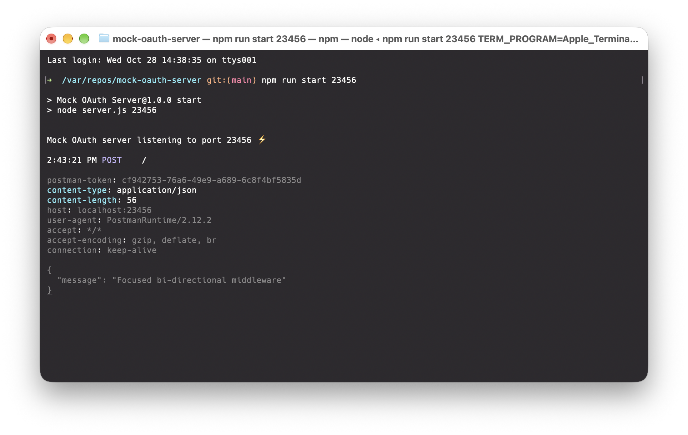

# Mock OAuth Server

An Express.js application to simulate local OAuth2 authentication endpoints.



## Installation

Use JavaScript Package Manager [npm](https://www.npmjs.com/) to install Mock OAuth Server.

```bash
npm install
```

## Usage

Use JavaScript Package Manager [npm](https://www.npmjs.com/) to run Mock OAuth Server.

```shell
npm run start
```

## Configuration

Adapt the configuration files to your needs:

- config/auth.json : set scope, expiry range and access token
- config/routes.json : set endpoints for access token, introspection and user info
- config/user.json : set mock user info

## Endpoints

## Contributing

Pull requests are welcome. For major changes, please open an issue first to discuss the proposed changes.

## License

[GNU GPL 3.0](https://www.gnu.org/licenses/gpl-3.0.en.html)
